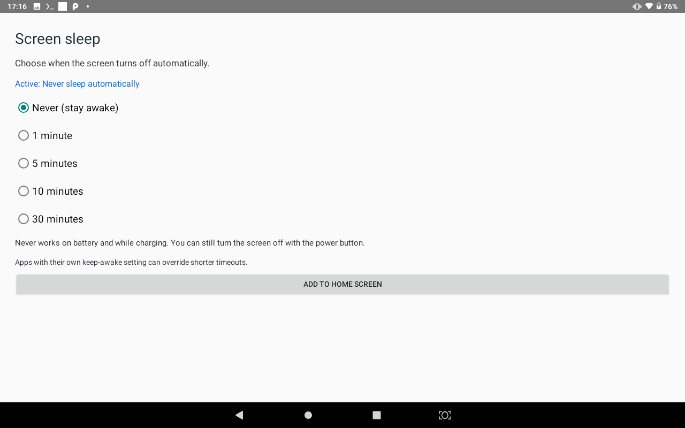

# Screen sleep

[](https://github.com/simdsz1z/screen-sleep/actions/workflows/build.yml)

A small Android app that adds a visible **Never (stay awake)** choice alongside 1, 5, 10 and 30 minute screen timeouts. Built to make an old learning tablet usable when its firmware only offers a 30-minute maximum.

**[Download the APK](https://github.com/simdsz1z/screen-sleep/releases/latest)** · [Source](src/local/g50/screensleep) · [MIT license](LICENSE)



## Use it

1. Download `Screen-sleep.apk` from Releases and install it. Android may ask you to allow installation from your browser or file manager.
2. Open **Screen sleep** and tap **Allow system settings changes**. Enable the permission and return to the app.
3. Choose **Never** or a shorter timeout. The first opening with permission granted activates Never.
4. Optionally tap **Add to Home screen**. While Never is running, its notification also opens the control.

Never keeps the screen on on battery and while charging. The power button can still turn it off manually. Choosing a shorter timeout stops the app's keep-awake service.

This is a separate control. It does **not** modify Android's built-in Settings menu, replace the firmware or require root.

## Compatibility and behavior

- Minimum Android version: **8.0 / API 26**. Tested on a **G50 tablet with Android 9 / API 28**. Other devices and newer Android versions have not been verified.
- A persistent foreground service holds a screen wake lock in Never mode. Android's screen wake-lock API is deprecated but available on the tested tablet; this app deliberately targets its older Android environment.
- The selected mode is saved. A boot receiver is configured to restart Never after reboot; reboot behavior has not been tested on the original tablet.
- Firmware battery restrictions or force-stopping the app may stop its service. If needed, allow unrestricted battery use in Android's app settings.
- Apps such as Termux:X11 can keep the screen awake independently. Android's developer setting to stay awake while charging also overrides shorter timeouts.
- Never additionally sets Android's timeout to `2147483647` milliseconds, about 24.9 days, as a fallback. The active service provides the indefinite behavior. If you uninstall or force-stop the app, that long timeout remains until changed. **Choose a shorter timeout before uninstalling**, or change it in Android Settings afterward.
- Changing the timeout in Android Settings does not stop an already running Never service. Use this app to turn Never off.

## Privacy and permissions

No Internet permission, ads, analytics, accounts or runtime libraries. The app stores only the chosen timeout in its private preferences.

| Permission | Purpose |
| --- | --- |
| Modify system settings | Set Android's screen timeout |
| Wake lock | Keep the screen awake in Never mode |
| Foreground service | Keep the control running with a visible notification |
| Receive boot completed | Restore Never after restarting the device |

## Build

Requires Python 3.9+, a JDK (tested locally with JDK 21; CI uses JDK 17), and the official Android SDK with platform `android-35` and build tools `35.0.0`.

```sh
sdkmanager "platforms;android-35" "build-tools;35.0.0"
python build.py --sdk /path/to/Android/Sdk
```

Alternatively set `ANDROID_HOME` instead of passing `--sdk`. Set `JAVA_HOME` if the JDK tools are not on your PATH. The script works with Windows and Unix SDK layouts and uses no Gradle or Maven dependencies.

Output: `build/Screen-sleep.apk` and `build/SHA256SUMS.txt`. The default build creates a **local development signing key** under `build/`, which is ignored by Git. Its certificate differs from the published release, so it cannot update an installed release APK in place.

For your own release, keep the signing key outside the repository, set `SCREEN_SLEEP_KEYSTORE_PASSWORD`, and run:

```sh
python build.py --keystore /private/path/release.p12 --alias screen-sleep
```

Release signing keys and passwords are never needed by CI. GitHub Actions builds a development APK for each push and pull request; installable releases are signed separately.

## ADB setup for restricted firmware

If the firmware hides the permission screen, enable USB debugging and authorize your computer, then run:

```sh
adb install -r Screen-sleep.apk
adb shell appops set local.g50.screensleep WRITE_SETTINGS allow
adb shell am start -n local.g50.screensleep/.MainActivity
```

Optional exemption if the firmware stops the foreground service:

```sh
adb shell dumpsys deviceidle whitelist +local.g50.screensleep
```

These commands require an already authorized ADB connection. They do not bypass a lock screen or device-management policy.

## Verified on the original tablet

- APK installation and signature verification.
- Never acquires a screen wake lock and remains active after returning to Android Home.
- Selecting 30 minutes updates the system timeout and releases the wake lock; selecting Never restores it.
- The power button still puts the tablet to sleep.
- Android Home shortcut pinning and launching from a Termux desktop shortcut.

The release also makes the permission prompt explicit, so declining it does not repeatedly reopen Android's permission page.

## Development

Open an issue with your Android version, device model and steps to reproduce a problem. Pull requests should keep the app small, offline and compatible with its stated minimum API. Include a successful build and relevant device checks; do not commit APKs, local device data or signing keys.

See the official [PowerManager API](https://developer.android.com/reference/android/os/PowerManager.html) and [system settings API](https://developer.android.com/reference/android/provider/Settings.System) for implementation details.
